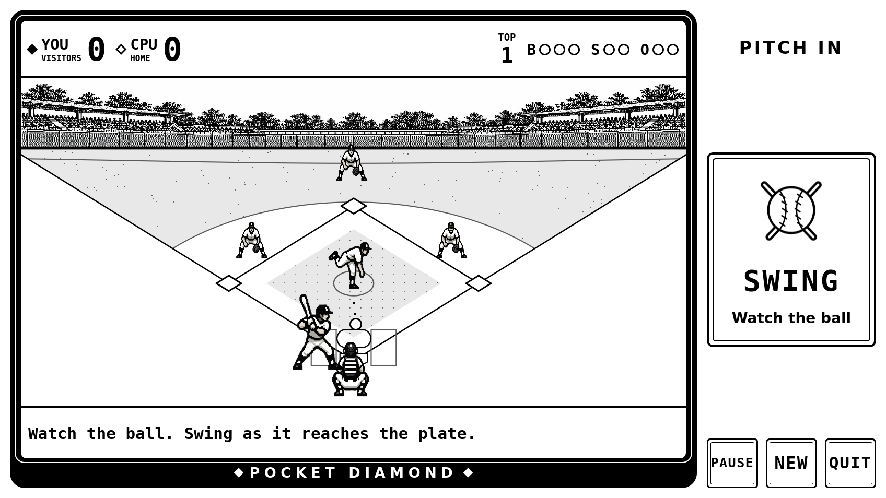
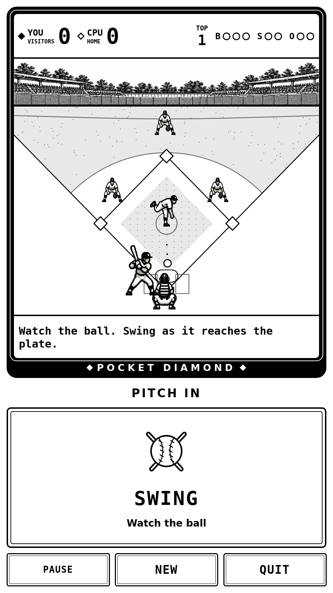

# Pocket Diamond

**Retro handheld baseball for reMarkable.** Watch the pitch, time your swing,
and play a quick game against the computer — with animated pixel-style players,
an illustrated ballpark, and one big **SWING** button.

Built for the **reMarkable Paper Pro Move**, using native QML and
[AppLoad](https://github.com/asivery/rm-appload). No backend or network connection
is needed to play.



## A little ballpark on your tablet

- Animated windup, pitch, swing, ball flight, and base running.
- One batting control: **SWING**. Let the pitch go by to take it.
- Outside pitches visibly drift to the side. Chase one and you miss.
- Pitch against the CPU with fastballs, curves, and changeups.
- One- or three-inning games, with extra innings for ties.
- Landscape and portrait layouts, pause/resume, and a final line score.
- **Relaxed / Classic** pace and **Smooth / Stepped** motion settings.

<p align="center">
  
</p>

*Screenshots are desktop Qt renders of the actual game UI. They show the layout
and artwork, not the tablet's physical refresh behavior.*

## How to play

Choose **BAT FIRST** or **PITCH FIRST**, then play one or three innings.

**Batting:** pitches come automatically. Tap **SWING** as the ball approaches
the plate. A correctly timed swing at a strike puts the ball in play for a
random hit or out. No tap means take: a strike is called, an outside pitch is
a ball. Relaxed pace provides a roughly **1.2-second contact window**.

**Pitching:** select **FAST**, **CURVE**, or **CHANGE**, then **INSIDE**,
**MIDDLE**, or **OUTSIDE** to throw. Middle is easier to hit; the corners are
harder to hit but more likely to miss the zone.

Three outs changes sides. Four balls is a walk; three strikes is an out.
Hits advance runners by the number of bases hit. Some groundouts advance
runners and flyouts can score a runner from third. **PAUSE** freezes play.
There is no saved game; quitting ends the current game.

## Install from source

### Requirements

- A reMarkable with developer mode, SSH access, and AppLoad already installed.
- Docker, Git, and an SSH/SCP client on your computer.
- A compatible [reMarkable SDK](https://developer.remarkable.com/links).
  The current device build uses Qt **6.8.2** and the **5.7** SDK.

This version has been installed on a Paper Pro Move. Other models and firmware
versions have not been verified. Installing AppLoad itself is outside this repo.

```bash
git clone https://github.com/snydersaurus/remarkable-baseball.git
cd remarkable-baseball

# First build: create the SDK Docker image from your downloaded installer.
./build.sh /path/to/remarkable-toolchain.sh

# Later builds reuse the image.
./build.sh

# Install over USB; the tablet must be awake.
./deploy.sh
```

The installer copies the bundle into
`/home/root/xovi/exthome/appload/baseball` and restarts **xochitl** so AppLoad
loads the updated icon and frontend. This returns the tablet to its lock screen.
Unlock it and open **AppLoad → Pocket Diamond**.

For another SSH address, use `RM_HOST=your-tablet-address ./deploy.sh`.
Set `NO_RESTART=1` to copy the files and restart the interface yourself later.
The SDK installer and generated bundles are excluded from Git.

## Motion on e-paper

**Smooth** mode is the default. Ball and runner movement use smaller steps,
while native AppLoad requests its animation display mode only over the field
during moving play. Pausing or finishing a play removes that override.
Unsupported AppLoad versions fall back to ordinary refresh handling.

**Stepped** mode uses the earlier, chunkier motion cadence and standard refresh.
Try it if Smooth leaves too much ghosting on your firmware. Neither mode changes
global tablet display settings. Physical smoothness depends on the device;
this remains an early game with room for tuning.

## Development

The game is frontend-only QML with a seeded JavaScript rules engine.

| File | Purpose |
| --- | --- |
| `ui/Baseball.mjs` | Baseball rules, CPU decisions, seeded randomness |
| `ui/Game.qml` | Game state, input, timing, and controls |
| `ui/Motion.mjs` | Discrete delivery, ball-flight, and runner frames |
| `ui/Field.qml` | Field, scoreboard, players, and results |
| `ui/PixelSprite.qml` | Shared sprite-atlas viewport |
| `ui/RefreshArea.qml` | Optional native AppLoad animation refresh area |
| `assets/` | Original generated player and stadium artwork |

See [development notes](docs/DEVELOPMENT.md) for checks and screenshot commands.

## Credits and license

By Bill Snyder. Built with Qt Quick and [AppLoad](https://github.com/asivery/rm-appload)
by asivery. Original player and stadium artwork was generated for this project
with AI tools, inspired by the visual language of classic handheld sports games.

[MIT license](LICENSE). This is an independent project, not affiliated with
reMarkable or Nintendo.
